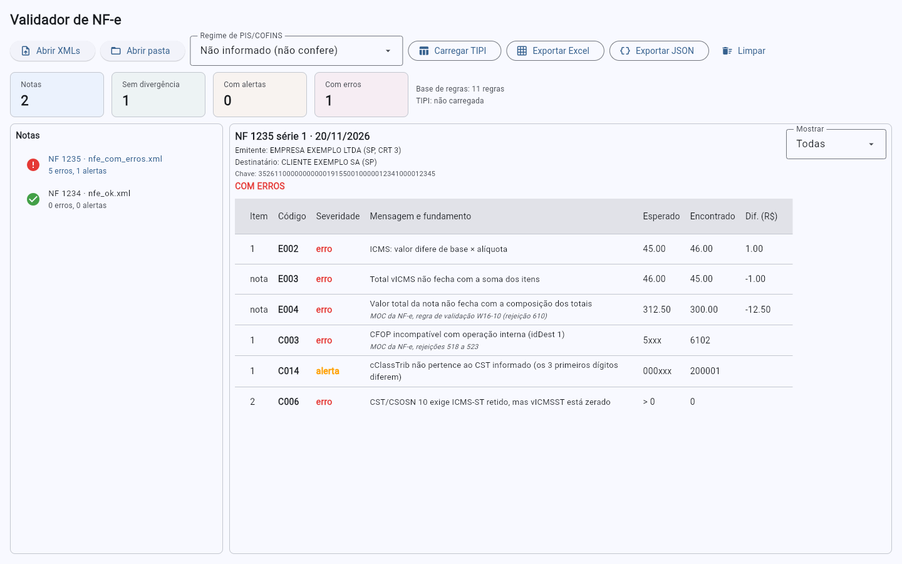

# validador-nfe

Valida a tributação de NF-e (modelo 55): ICMS, ICMS-ST, IPI, PIS/COFINS e o grupo IBS/CBS da Reforma Tributária (LC 214/2025).

Fases entregues: **Fase 0** (leitura do XML e checagens que não dependem de regras) e **Fase 1, início**
(base de regras com vigência e determinação para ICMS próprio de SP, IPI pela TIPI, PIS/COFINS e IBS/CBS de 2026).
A arquitetura e o roadmap estão em [Motor de validação tributária: arquitetura e MVP](https://claude.ai/artifact/LQf3RbyYCkND6m2KAvBcwQ).

## Uso

```bash
pip install -e ".[dev]"
validador-nfe pasta_ou_xml/ --xlsx relatorio.xlsx --json relatorio.json
validador-nfe nota.xml --xsd schemas/nfe_v4.00.xsd   # valida também o schema oficial
validador-nfe notas/ --regime-pis-cofins nao_cumulativo --tipi tipi.csv   # confere PIS/COFINS e IPI
validador-nfe notas/ --sem-regras   # só checagens da Fase 0
```

## Interface gráfica

```bash
pip install -e ".[gui]"
validador-nfe-gui                 # janela de desktop
validador-nfe-gui notas/          # abre já validando uma pasta
validador-nfe-gui --web           # no navegador
```



A tela lista as notas com a situação de cada uma e, ao clicar, mostra as divergências com o fundamento.
O regime de PIS/COFINS e a TIPI podem ser escolhidos na própria tela, e o relatório sai em Excel ou JSON.

## Executável para Windows

O executável é gerado no seu computador, com o Python que você já usa. No PowerShell, na pasta do projeto:

```powershell
powershell -ExecutionPolicy Bypass -File ferramentas\gerar_exe.ps1
```

O script instala as dependências (`.[gui,exe]`), roda os testes, gera o ícone e empacota com `flet pack`.
O resultado é `dist\ValidadorNFe.exe`, um arquivo único com o ícone e a base de regras dentro.
Por padrão ele usa `%LOCALAPPDATA%\Python\pythoncore-3.14-64\python.exe`; para outro Python, passe `-Py "C:\caminho\python.exe"`.


O ícone é desenhado por `ferramentas/gerar_icone.py` (Pillow). Para trocar cores ou formas, edite o script e gere de novo.
Para usar outra base de regras com o executável, defina a variável de ambiente `VALIDADOR_REGRAS` com a pasta dos CSV.

## Linha de comando

O comando sai com código 1 se alguma nota tiver erro, o que permite usá-lo em pipelines.

```python
from validador_nfe import ler_nfe, validar

for d in validar(ler_nfe("nota.xml")):
    print(d.severidade.value, d.codigo, d.mensagem)
```

## Checagens

| Código | Severidade | O que verifica |
| --- | --- | --- |
| E001 | erro | vProd = qCom × vUnCom |
| E002 | erro | valor de cada tributo = base × alíquota (ICMS, ST, FCP, IPI, PIS, COFINS, IBS, CBS) |
| E003 | erro | totais do ICMSTot = soma dos itens |
| E004 | erro | composição do vNF |
| C001 | erro | CST × CSOSN conforme o CRT do emitente |
| C002 | erro | CFOP de entrada em nota de saída e vice-versa |
| C003 | erro | 1º dígito do CFOP × idDest |
| C004 | erro | idDest × UF do emitente e do destinatário |
| C005 | erro | NCM com 8 dígitos |
| C006 | erro | ST exigida pelo CST (10, 30, 70, 201 a 203) ou indevida (60, 500) |
| C007 | alerta | item com ST sem CEST |
| C008 | erro/alerta | CST 00, 20, 40, 41, 50 coerentes com o ICMS destacado |
| C009 | alerta | alíquota interestadual diferente de 4, 7 ou 12% |
| C010 | alerta | venda interestadual a não contribuinte sem DIFAL |
| C011 | alerta | CST de PIS diferente do de COFINS |
| C012 | alerta | nota de 2026 em diante sem grupo IBSCBS (regime normal) |
| C013 | erro | formato do CST (3 dígitos) e do cClassTrib (6 dígitos) |
| C014 | alerta | cClassTrib não começa pelo CST |
| D001 | erro/alerta | alíquota diferente da regra vigente (alerta quando a regra é genérica, sem NCM/CEST) |
| D002 | erro | IPI destacado para NCM não tributado na TIPI |

Tolerância de arredondamento: R$ 0,01 por valor.

## Base de regras

As regras ficam em CSV na pasta [`regras/`](regras/README.md), cada uma com vigência e fundamento legal.
Vence a regra mais específica que casa com a operação.

## A conferir

Os parâmetros legais em `src/validador_nfe/parametros.py` foram escritos de memória e precisam ser conferidos
na legislação e nas Notas Técnicas vigentes. A leitura do grupo IBSCBS segue a NT 2025.002; versões mais novas
da NT podem ter mudado nomes de campos. Os XSD oficiais não vêm no repositório: baixe no Portal da NF-e.

## Testes

```bash
pytest
```

As notas em `tests/fixtures/` são fictícias. Para a meta da Fase 0 (50 notas reais sem falha de leitura),
use notas reais anonimizadas e nunca as versione.
